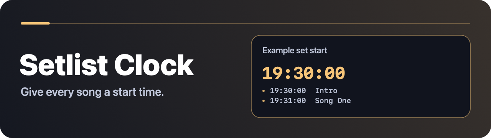

<p align="center">
  
</p>

# Setlist Clock

Lay out song, rehearsal, or video segments on a clock. Enter one item per line with a tab between its title and duration. Durations accept seconds, minutes and seconds, or hours, minutes, and seconds.

## At a glance

| Task | How |
| --- | --- |
| **Lay out a set** | Enter a title and duration on each tab-separated line. |
| **Start at a specific time** | Use `--start` to put the set on a clock. |
| **Leave space between items** | Use `--gap` to add a pause between entries. |

## Quick start

```text
Intro	0:45
Song One	3:24
Outro	1:08
```

```sh
python3 setlist_clock.py setlist.tsv --start 19:30 --gap 15
```

Requires Python 3.8+. With no start time, output is relative to zero. Optional gaps apply between items. An end time after midnight includes a day offset. [MIT](LICENSE)
